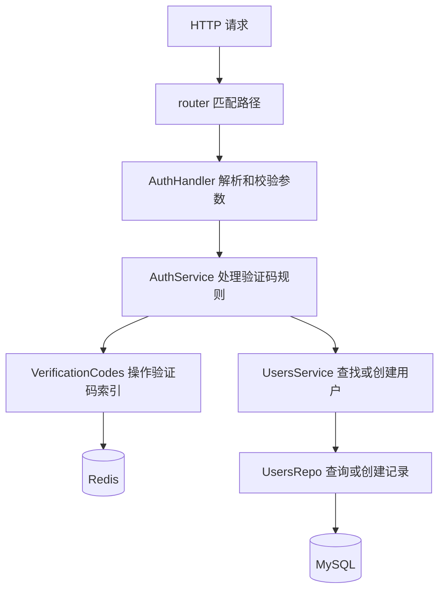

这个 server 目前负责微信回调、生成验证码、消费验证码，以及查找或创建对应用户。原来的 handler、service、repository 分层可以继续使用，主要问题是各层的职责没有完全分开，而且有些错误没有返回给调用方。这次调整保留了原来的总体结构，把配置读取、数据库操作和 HTTP 响应各自放回合适的位置。

建议你按照下面的顺序读代码，先跟着一个请求走通，再考虑目录应该怎么分。

| 阅读顺序 | 文件 | 重点看什么 |
| --- | --- | --- |
| 1 | `main.go` | 如何创建依赖，如何把依赖传给下一层 |
| 2 | `internal/config/config.go` | 为什么只在启动时读取环境变量 |
| 3 | `internal/router/auth.go` | URL 如何对应 handler 方法 |
| 4 | `internal/handler/auth.go` | 解析参数、调用 service、返回 HTTP 响应 |
| 5 | `internal/service/auth.go` | 验证码的有效期、碰撞重试、错误判断 |
| 6 | `internal/service/users.go` | 什么时候查找用户，什么时候创建用户 |
| 7 | `internal/repository/users.go` | GORM 查询、创建、唯一索引冲突 |
| 8 | `internal/repository/verification_codes.go` | Redis 的两个索引为什么要一起操作 |

请求实际经过的链路是这样的。箭头表示调用方向，结果和错误会沿着调用链返回。



handler 关心的是外部请求怎么进来、结果怎么返回。例如请求体不是合法 JSON，或者验证码不是六位数字，就应该在这里返回 400。至于 Redis 怎么保存验证码、MySQL 怎么找用户，handler 不需要知道。微信回调使用 XML，网页接口使用 JSON，这些差异也留在 handler。

service 负责业务规则。比如当前用户还有未过期的验证码时，不重复发送；验证码碰撞时，重新生成；第一次验证成功的用户需要创建资料。这些规则不应该散落在 HTTP 处理和数据库查询里。原来的 UsersService 只有一层转发，单看那时的代码，单独建立它的价值不大。现在它负责 FindOrCreateUser，保留这一层就有了具体理由。

repository 负责存取数据。MySQL 的查询条件和 Redis 的键名都在这里，service 不再自己拼 Redis 命令。database 包只负责创建连接，不能因为它叫 database，就把所有查询也塞进去。连接初始化和用户查询是两种不同的工作。

目前 UsersService 仍直接识别 gorm.ErrRecordNotFound，AuthService 仍识别 redis.Nil。这是当前规模下保留的一点依赖。以后如果真的需要更换存储实现，可以再让 repository 把它们转换成自己的错误，不必现在就增加完整的抽象层。

Go 没有要求所有后端都必须照搬某一套目录。internal 有 Go 工具链规定的导入范围，但 handler、service、repository 这些名字都是项目自己的约定。你现在只有一个启动入口，继续把 main.go 放在 server 根目录就可以，不需要为了规范再搬到 cmd/api。等有多个独立程序需要启动时，再考虑 cmd 目录。

Go 的文件也不是一个文件对应一个类。同一目录下声明相同 package 的文件共同组成一个包，可以按职责拆成多个文件。文件名叫 auth.go，主要是方便人查找，并不会自动建立一层隔离。真正决定访问范围的是包和标识符的大小写。

这次把 errType 包里的业务错误移到了 service/errors.go，并改成 ErrCodeActive、ErrInvalidCode。包名一般使用简短的小写单词，错误变量通常以 Err 开头。这里只剩两个认证错误，没必要专门建一个混合命名的包。AuthHandler 的依赖字段也改成小写，外部只需要调用构造函数，不需要随时修改它内部使用的服务。

下面这些是原来会影响实际行为的地方，不只是代码风格差异。

| 原来的情况 | 现在的处理 | 原因 |
| --- | --- | --- |
| MySQL 连接信息写在源码中 | config.Load 读取本地配置，再传入连接函数 | 换环境时不需要修改业务源码 |
| handler 每次请求读取微信令牌 | 启动时读取并注入 | 配置依赖清楚，缺少配置时立即失败 |
| service、repository 接收 gin.Context | 改成 context.Context | 业务代码可以脱离 HTTP 调用 |
| 用户查询用 0 表示所有失败 | 返回完整用户和 error | 用户不存在与数据库故障需要分别处理，也能复用用户资料 |
| 查询没有使用传入的上下文 | GORM 使用 WithContext | 请求取消后，下游操作可以停止 |
| Redis 写入结果没有检查 | 原子检查和写入，并返回错误 | 不再出现只写入一个索引或误关联用户 |
| service 对 Redis 错误执行 panic | 正常返回包装后的错误 | 运行中可能发生的失败不应该靠 panic 处理 |
| Verify 遇到未知错误继续返回成功 | 记录错误并返回 500 | 前端才能正确判断本次操作是否成功 |
| 创建用户的方法没有返回结果 | 返回完整用户和错误 | 后续签名可取 user.ID，用户资料也不必重新查询 |
| UsersHandler 只有结构体，没有行为 | 删除未使用的文件 | 有用户接口时再添加对应 handler |
| VerifyToken 是空函数 | 实现 AuthService.VerifyToken，检查签名、算法、签发者和有效期 | 不能把解码成功当成认证成功 |
| HS256 签名传入 string 密钥 | 转成字节切片 | 这个签名方法要求的是字节切片 |

可以重点看用户查询的写法。

```go
// internal/repository/users.go
// WithContext 把请求取消信号传给数据库操作。
var user model.Users
err := u.db.WithContext(ctx).Where("openid = ?", openid).Take(&user).Error
if err != nil {
    // %w 保留原来的错误，让上层继续使用 errors.Is 判断。
    return nil, fmt.Errorf("根据 openid 查询用户: %w", err)
}
return &user, nil
```

以前只看 RowsAffected，查不到记录和查询失败都可能变成 0。现在我们先检查 Error，让数据库断开这样的故障直接返回。UsersService 只有在 errors.Is 确认是 gorm.ErrRecordNotFound 时才创建用户。这种写法的重点是让每一步的结果都可以解释，不要把失败塞进某个特殊数字里。

错误向上传递时，用 fmt.Errorf 配合 %w 添加当前步骤。日志最终能看到是查用户失败，还是保存验证码失败。handler 对外只返回适合用户阅读的消息，具体数据库错误留在服务端。通常在请求边界记录一次错误就够了，每一层都打印一次会产生重复日志。

context.Context 不是专门给 Gin 准备的，它是标准库类型。handler 把 c.Request.Context 传下来，repository 再交给 Redis 或 GORM，请求的取消信号就能继续传递。把 ctx 当成函数第一个参数是常见约定，不要把某个请求的 ctx 保存到长期复用的 service 结构体里。

验证码部分比普通查询多了一点代码，是因为这里有真实的并发问题。原来先查 TTL，再执行两次 SetNX，每一步之间都可能插入其他请求。用户索引写成功，不代表验证码索引也成功。如果两个用户碰巧生成相同验证码，就不能把其中一个用户的验证码发送出去，同时让它查到另一个用户。

现在 repository 使用一段 Redis Lua 脚本，先检查用户索引，再检查验证码索引，两个条件都满足后才写入。service 收到碰撞结果时最多重新生成五次，遇到已有验证码则返回业务错误。Lua 脚本也加了中文注释，你可以先理解两个索引必须保持一致，再逐行看 Redis 命令。

消费验证码时也同时删除两个索引，所以并发提交同一个验证码只有一个请求会成功。这里的原子性表示执行过程中其他 Redis 命令不会插进来，并不意味着 Redis 脚本在任何运行错误下都支持事务回滚。这份实现面向当前的单机 Redis，没有加入 Redis Cluster 的跨槽支持。

Redis 和 MySQL 之间仍然不是一个事务。验证码先被消费，如果后续 MySQL 故障，接口会返回 500，这个验证码也不能再次使用，用户需要重新获取。当前项目接受这个取舍，避免验证码被重复使用。将来确实需要失败重试时，再设计状态记录或幂等处理。

创建用户时仍然依赖 sql/init.sql 中 openid 的唯一索引。正常插入成功后，GORM 会回填自增 ID 和 CreatedAt，直接返回当前用户结构体就可以，不需要再查一次。两个请求同时判断用户不存在时，唯一索引能防止插入重复用户；收到 MySQL 1062 错误后，再查询已经保存的完整用户资料，不能把本次未保存的默认昵称当成已有用户资料返回。昵称按照你现有表的约定生成 16 位随机字符串，角色明确写入 user，避免空字符串覆盖数据库默认值。

FindUserByOpenID、CreateUser、FindOrCreateUser 和 VerifyCode 都返回完整用户。AuthService.Login 内部调用 VerifyCode 取得用户，再调用 GenerateToken(user.ID) 签发令牌，返回 LoginResult。签名失败时整个登录返回错误，不返回一部分成功结果。handler 调用 Login 后再写入 Cookie，service 不引用 Gin，也不负责 HTTP 响应。

token 和 userinfo 两个 Cookie 都设置 Path=/、SameSite=Lax，有效期与令牌统一为两小时。token 设置 HttpOnly，JavaScript 不能读取；userinfo 不设置 HttpOnly，内容仅包含字符串形式的 id、name 和 role。userinfo 的 role 只用于界面展示，服务端不能用它判断权限。用户资料先序列化为 JSON，再用 URL 编码保存，前端读取 Cookie 值后使用 decodeURIComponent，再执行 JSON.parse。

当前 Cookie 不设置 Domain，因此只属于当前主机。后端直接处理 HTTPS 请求时会设置 Secure，本地 HTTP 开发时不设置。若之后由反向代理终止 HTTPS，再以 HTTP 转发给 Go，需要同步调整 Secure 配置，不能直接信任客户端传来的转发请求头。前后端跨站点或不同主机部署时也需要重新配置 Cookie 和跨域策略；当前设置面向同站点、同主机的开发方式。

JWT_SECRET 在 config.Load 中检查，缺失或全是空白字符时启动失败。GenerateToken 直接调用 os.Getenv 读取进程环境，不需要各层传递密钥，也不会每次读取 .env 文件。这个函数因此依赖运行环境，测试时用 t.Setenv 设置密钥并自动恢复即可。如果以后希望配置固定在实例上，也可以由 main 创建 AuthService 时直接注入密钥，不需要经过 handler 或每次请求逐层传参。

接口也不是越多越规范。目前只在 handler 一侧定义了它需要的两个 service 方法，因为 HTTP 测试需要模拟验证码过期和数据库故障。其他地方继续使用具体类型，避免每个结构体都机械地配一个接口。以后某个调用方确实需要替换实现，再在调用方定义小接口。

一些现有命名保留了下来，比如 Users、Articles、Folders。Go 里描述单个实体时经常使用 User、Article、Folder，但这不是编译规则，当前名称也能正确映射数据库表，没必要把所有文件都改一遍。更值得先统一的是 ID 使用 uint64、错误必须返回、接收者尽量一致使用指针，这些直接影响调用和维护。

constant/time.go 里的 Day 和 Month 已改成 const，因为固定时长不需要运行时修改。这里的 Month 仍然表示 30 天，不是自然月。将来如果要计算下个月同一天，应该使用 time.AddDate，不能把固定 30 天直接当成日历月份。

client、crypto、filter、migrations、scripts 这些预留目录目前只有占位文件，不参与运行。这次没有往里面填框架代码。你可以等确实接入外部服务、编写数据库变更脚本时再使用它们。当前初始化 SQL 仍放在 sql/init.sql，也没有引入自动建表，避免启动服务时隐式修改数据库。

登录流程相关的中文注释已跟随代码更新。VerifyCode 负责消费验证码并取得用户，Login 负责组织验证与签名，handler 负责选择展示字段并写入 Cookie，避免把 HTTP 细节混进业务服务。

本地启动需要 Go 1.26、MySQL 和 Redis。从 server 目录执行命令，config.Load 会读取这个目录下的 .env。已有本地 .env 保留了原配置，并将原先写死在 mysql.go 的连接信息迁移成 MYSQL_DSN；如果本来已经有 MYSQL_DSN，就不覆盖。共享给其他开发者的是 .env.example，真实密码和微信令牌留在本机。

如果是全新检出的项目，复制 .env.example 为 .env 后填写自己的数据库账号和微信回调令牌。数据库还没有初始化时再执行 sql/init.sql，已经有表的环境不要重复运行初始化 SQL。

```bat
rem 在仓库根目录打开 CMD，进入后端目录。
cd server
rem 安装 go.mod 中声明的依赖。
go mod download
rem 启动服务，默认监听 127.0.0.1:8080。
go run .
```

config.Load 会优先保留系统环境变量，.env 用于补充本地配置。缺少 MYSQL_DSN、WECHAT_CALLBACK_TOKEN 或 JWT_SECRET 会直接报错。Redis 会在启动时做一次带超时的 Ping；MySQL 示例连接配置也带有连接超时。main 调用 run，在 run 正常返回或启动失败时执行 defer 关闭连接。强制终止进程不会保证执行 defer，当前也没有新增优雅停机机制。

健康检查 GET /health 只说明 HTTP 能响应，不会逐次检查数据库。应用启动本身仍然要求配置和依赖服务可用，所以它不能用来证明 MySQL、Redis 始终正常。

```bat
rem 测试不连接真实 MySQL，也不会操作开发环境中的 Redis。
go test ./...
rem 检查常见的 Go 代码问题。
go vet ./...
```

HTTP 测试覆盖验证码格式校验、验证码过期和服务故障，签名测试覆盖微信回调的合法签名和空令牌。Redis 测试使用 miniredis，验证验证码碰撞、五分钟过期、重复消费和并发消费。JWT 测试实际签名再解析，可以发现密钥类型错误。这些测试不等于真实 MySQL、真实 Redis 和微信公众号的端到端联调，部署前仍需验证实际连接和表结构。

POST /api/v1/auth/verify 保留原地址和成功响应格式，现在成功时已经完成用户查询或创建、令牌签发，并返回两个 Set-Cookie 响应头。参数错误、验证码过期、数据库故障或签名失败时不会写入新的登录 Cookie。GenerateToken 和 VerifyToken 都是 AuthService 方法；VerifyToken 已实现，但尚未接入保护文章接口的认证中间件。六位验证码接口的尝试频率限制也仍需后续实现。

如果你想自己重新敲一遍，建议从 UsersRepo.FindUserByOpenID 开始，接着实现 UsersService.FindOrCreateUser，再实现 AuthHandler.Verify。这样你会先理解数据库结果怎么返回，再理解业务如何决定下一步，接着看到这些结果怎样变成 HTTP 响应。把这条链路理解清楚之后，文章和文件夹模块就可以用同样的方式组织，不需要先准备更多目录。
